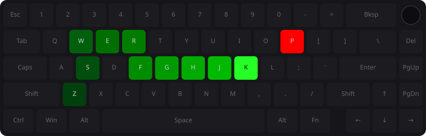
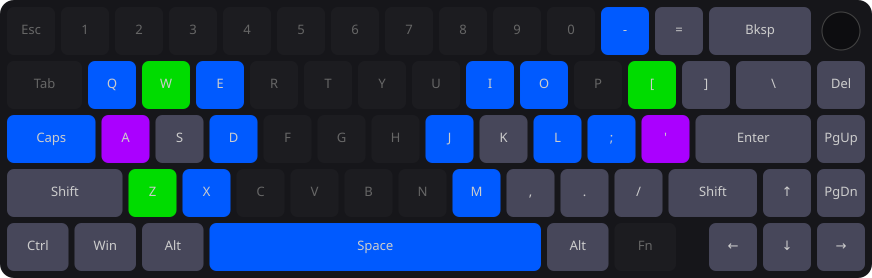
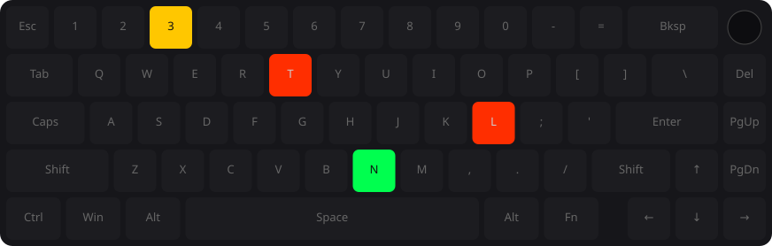
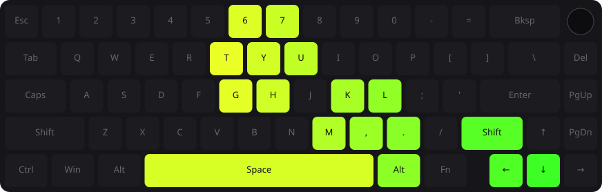
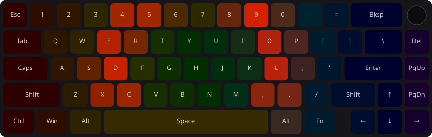

# gmk67-led-arcade

**Games you play on your keyboard's RGB lighting.** A green snake slithers across
the keycaps, apples appear as red keys, and you steer with the arrow keys. Or
dig for mines where every keycap is a cell, whack keys as they light up, solve
Lights Out on the whole board...

Built for (and tested against) the **Zuoya GMK67 V2**, but the games are
hardware-agnostic. They draw onto a model of the physical keyboard, and
*backends* push those frames to an on-screen simulator, an OpenRGB server, or
the GMK67's stock VIA firmware.



---

## Is this actually possible? (TL;DR)

I investigated a real GMK67 V2 before writing code. The full log is in
[docs/FEASIBILITY.md](docs/FEASIBILITY.md).

| Question | Answer |
|---|---|
| Is it fast enough to look good? | **Yes, easily.** The keyboard accepts ~470 lighting commands/s with a 2 ms round trip. A per-key frame would take ~8 USB reports, which is roughly **60 fps**. Snake needs 3-7 updates/s. |
| Can the **stock** firmware light individual keys? | **Not through documented VIA.** The firmware is a closed-source QMK derivative speaking VIA protocol v12, and VIA only exposes *global* lighting (effect, brightness, speed, one colour). |
| Any hidden per-key mode? | **Two promising leads**: an undocumented vendor command `0xBB` (the only unknown id that the firmware swallows silently) and a hidden lighting effect **#46** beyond the 45 listed in VIA. They have to be confirmed by eye, so there is an interactive probe for that: `tools/gmk67.py probe`. |
| So what works today? | All games run fully per-key in the **terminal simulator** and on any keyboard **OpenRGB** drives in Direct mode. The physical GMK67 joins in through the **`gmk67-ambient`** backend: the whole board takes the game's colour and flashes on events (apple eaten, death, win). |
| Custom firmware? | Possible in principle, since it's QMK-derived, but the MCU is unidentified (the case has to be opened), the wireless stack is proprietary, and flashing risks a brick. Documented as an option, not done. |

## Games

| Game | How it plays | Controls |
|---|---|---|
| **Snake** (`snake`) | Green snake with a bright head and fading tail; red apples (sometimes golden ones worth 3) pulse on random keys. It speeds up as you eat, and the board wraps at the edges. | Arrow keys |
| **Keysweeper** (`minesweeper`) | Minesweeper where *every keycap is a cell*. Neighbours are the keys physically touching each other, so the staggered rows make it a bit hexagonal. Clue numbers are colours. | Tap = dig, hold = flag |
| **Whack-a-Key** (`whack`) | Keys light up yellow and age to red; hit them before they vanish. 45 s rounds, 5 lives, and faster hits score more. | Press the lit keys |
| **Echo** (`echo`) | Memory game: the board plays a sequence of keys, you repeat it, and it grows each round. | Press the keys in order |
| **Lights Out** (`lightsout`) | Pressing a key flips it and every key touching it. Turn the whole board off. Levels get harder, and every puzzle is generated solvable. | Any key |
| **Ripple** (`ripple`) | Not a game: a rainbow drift where every key press sends out a ripple. Good for checking LED mapping. | Any key |

| Keysweeper | Whack-a-Key |
|---|---|
|  |  |
| **Lights Out** | **Ripple** |
|  |  |

Minesweeper clue colours: **1** blue, **2** green, **3** yellow, **4** orange,
**5** red, **6** pink. Dark = 0, grey = still hidden, purple = flag.

## Quick start

Requirements: Linux and Python ≥ 3.10. **No third-party packages.**

```bash
git clone https://github.com/borislisandro/gmk67-led-arcade
cd gmk67-led-arcade
python3 -m ledarcade            # menu
python3 -m ledarcade snake      # straight into a game
```

Or install it as a command: `pip install --user .` then `ledarcade snake`.

By default (`--backend auto`) you get the terminal simulator plus whichever hardware
backend is available: OpenRGB if a server is running, otherwise the GMK67
ambient backend if the keyboard is reachable. The status line at the bottom of
the game shows what was picked.

### Permissions (one-time)

* **Keyboard input (evdev):** your user must be in the `input` group
  (`sudo usermod -aG input $USER`, then log out and back in). Without it the game falls
  back to reading the terminal, which works but can't see modifier keys or
  key-release timing.
* **GMK67 lighting (hidraw):** install the udev rule so you don't need `sudo`:

  ```bash
  sudo cp udev/99-gmk67.rules /etc/udev/rules.d/
  sudo udevadm control --reload && sudo udevadm trigger
  ```

### Options

```
python3 -m ledarcade [game] [options]

  -b, --backend LIST     auto (default) or a comma list of: terminal, openrgb, gmk67-ambient
  --no-evdev             read keys from the terminal instead of the keyboard device
  --grab / --no-grab     grab the keyboard exclusively (default: on for games that
                         use every key, so Super/Alt/Ctrl don't trigger the desktop)
  --seed N               reproducible randomness
  --openrgb-host/--openrgb-port/--openrgb-device NAME
  --hidraw /dev/hidrawN  VIA node for gmk67-ambient (auto-detected)
```

Quitting: **Esc** in Snake. In games that use every key (where Esc is a cell),
**hold Esc for one second**. After a game ends, press **Space/Enter** to play again.

> When the keyboard is *grabbed*, key presses don't reach any other app,
> including the terminal, so Ctrl+C won't work. Hold Esc to quit. The grab is
> released automatically when the process exits.

## Backends

| Backend | What it drives | Per-key? |
|---|---|---|
| `terminal` | True-colour drawing of the GMK67 in your terminal | ✅ |
| `openrgb` | Any keyboard OpenRGB supports in Direct mode, through its SDK server (`openrgb --server`). It speaks the network protocol directly, so no dependency. LEDs are matched by name (`Key: A`, `Key: Left Shift`, ...). | ✅ |
| `gmk67-ambient` | The GMK67 V2's **stock firmware** over VIA: one colour for the whole board (the average hue of the game's lit keys) plus flashes on game events. Changes are RAM-only and restored on exit, and nothing is saved to EEPROM. | ❌ (global) |

## Probing your GMK67 for a per-key mode

This is the most useful next step, and it needs a human looking at the keyboard:

```bash
sudo python3 tools/gmk67.py backup            # keymap + macros + lighting -> json
sudo python3 tools/gmk67.py probe             # interactive; watch the keys
```

The probe turns the board blue, activates hidden effect 46 (and asks you what it
looks like), then sends batches of candidate `0xBB` packets in common per-key
layouts and asks *"did any key change?"*. If you answer yes, it bisects down to
the exact packet in about 10 more questions. Results go to `probe_results.json`.
A positive result is enough to build a real per-key `gmk67-direct` backend.

Other tool commands: `info` (firmware details), `bench` (measures the lighting
command rate), `restore <file>`.

## How it works

```
 ┌─────────────┐  KeyEvent   ┌──────────┐  Frame {key_id: (r,g,b)}  ┌─────────────────┐
 │ EvdevInput  │ ──────────▶ │   Game   │ ────────────────────────▶ │ terminal        │
 │ (or stdin)  │             │ (logic)  │   + events ("eat","die")  │ openrgb         │
 └─────────────┘             └──────────┘                           │ gmk67-ambient   │
        ▲                         ▲                                 └─────────────────┘
        └──── engine.py: 60 fps loop, Esc handling, restart ─┘
```

* **`layout.py`**: the GMK67 as a graph of 67 keys with real positions (from the
  vendor VIA JSON), matrix positions and Linux keycodes (verified against the
  board). `step()` moves between keys, carrying a "virtual column" so that going
  straight up through staggered rows doesn't drift sideways. `neighbours()`
  gives physically touching keys (used by Minesweeper and Lights Out).
* **`games/`**: each game implements `reset`, `on_key`, `update`, `render` and `status`.
* **`via.py`**: a dependency-free VIA client over `/dev/hidraw*`.
* **`backends/`**: the output targets described above.

### Writing a new game

```python
from ledarcade.games.base import Game

class Blink(Game):
    name, title, blurb, controls = "blink", "Blink", "toggle keys", "Any key"
    all_keys = True                      # Esc must be held to quit

    def reset(self, now):
        self.on = set()

    def on_key(self, ev, now):
        if ev.pressed:
            self.on ^= {ev.key}
            self.score = len(self.on)

    def render(self, now):
        return {k: (0, 120, 255) for k in self.on}
```

Register it in `ledarcade/games/__init__.py`. That's the whole API.

## Tests

```bash
python3 -m unittest discover -s tests -v
```

The tests cover layout geometry (row widths, unique keycodes, wrap-around,
drift-free vertical movement, neighbour symmetry), game rules (snake growth,
collisions, safe first dig, flagging, win/lose, Lights Out solvability via
GF(2) elimination), the OpenRGB packet parser, terminal input decoding, and a
one-minute random-input smoke test of every game.

## Roadmap

- [ ] Run `tools/gmk67.py probe` on the GMK67 and, if a per-key packet exists, add a `gmk67-direct` backend
- [ ] Measure VIA latency through the 2.4 GHz dongle (it exposes the same interface)
- [ ] Identify the MCU (open the case) to judge whether a QMK + OpenRGB port is realistic
- [ ] More games: Pong across two rows, a rhythm game, two-player Tron (WASD vs arrows)
- [ ] macOS/Windows input (currently Linux-only: evdev + hidraw)

## License

MIT
